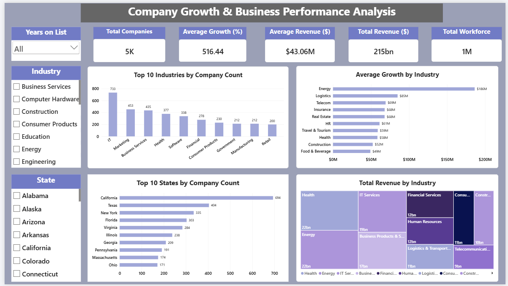
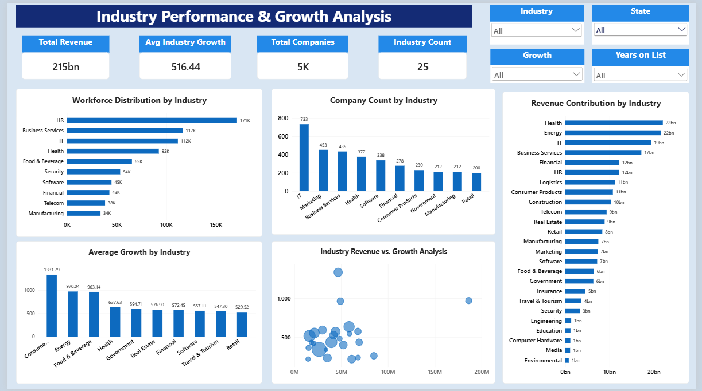
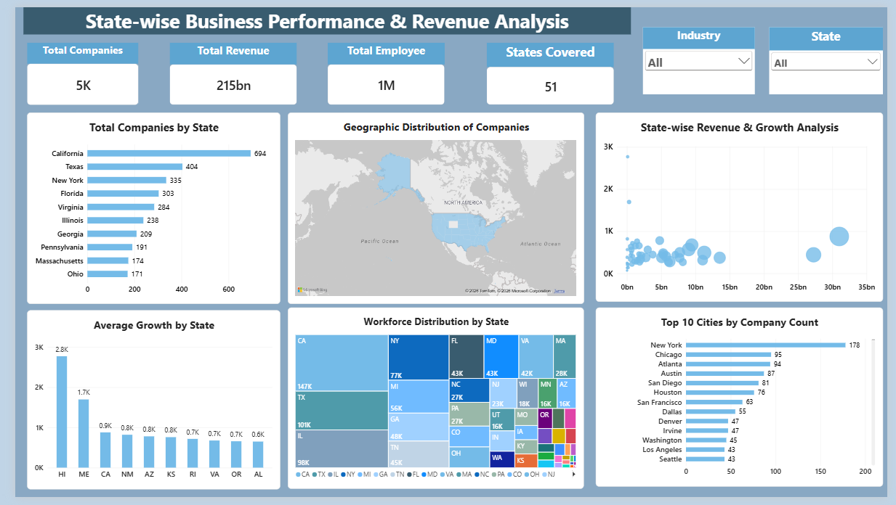

# Business Performance Analysis & Interactive Dashboard Development

## Project Overview
This project focuses on analyzing business performance using Microsoft Power BI. The dataset contains 5,000 companies across 25 industries and 51 states.

The project provides interactive dashboards to analyze company revenue, workforce distribution, business growth, and industry performance.

## Tools & Technologies
- Microsoft Power BI
- Power Query
- DAX
- Data Cleaning
- Data Visualization

## Project Objectives
- Analyze overall business performance.
- Compare revenue across different industries.
- Understand state-wise business distribution.
- Identify top-performing companies.
- Analyze workforce and business growth.

## Dashboard Details

### 1. Executive Business Overview
Provides an overview of company performance using KPI cards and interactive visualizations.

### 2. Industry Analysis
Analyzes industry-wise revenue, workforce, and business performance.

### 3. State-wise Business Performance & Revenue Analysis
Compares business performance and revenue across different states.

## Key Features
- Interactive KPI cards
- Dynamic charts and visualizations
- DAX measures
- Interactive slicers
- Business performance comparisons

- ## Dashboard Preview

### 1. Executive Business Overview

### 2. Industry Analysis

### 3. State-wise Business Performance & Revenue Analysis

## Project Files
- POWERBI PROJECT.pbix – Power BI dashboard file
- Dashboard screenshots – Visual representation of the dashboards

## Conclusion
This project demonstrates practical skills in data cleaning, data modeling, DAX calculations, and interactive dashboard development using Power BI.
